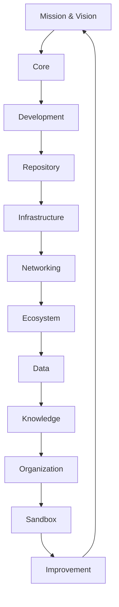
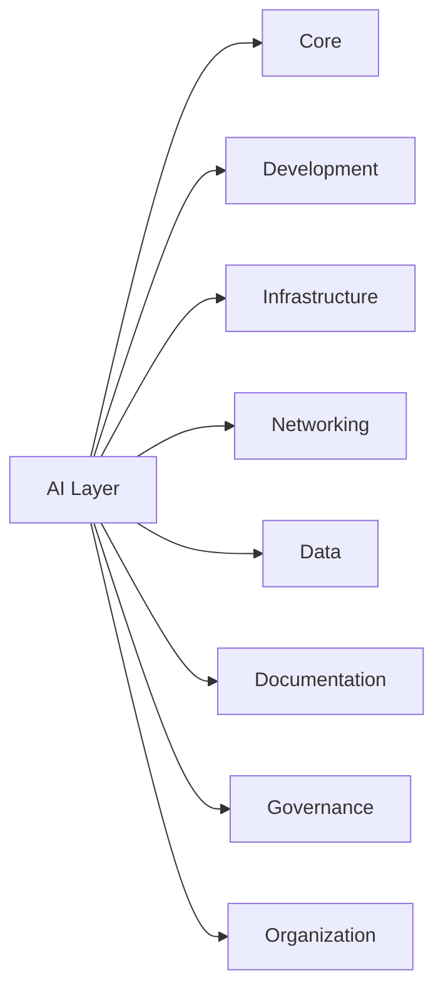
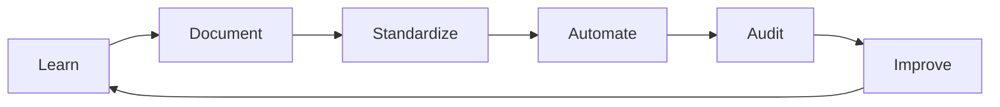

# Sovereign Knowledge Laboratory

> Building a Sovereign Knowledge Operating System for Infrastructure, Development, Documentation, Governance, AI, and Organizational Intelligence.

---

## Mission

The purpose of this laboratory is not merely to store documents.

The purpose is to create a **living knowledge system** where:

- Knowledge becomes structured
- Documentation becomes operational
- Operations become reproducible
- Governance becomes transparent
- AI becomes contextual
- Decisions become auditable
- Experience becomes institutional memory

---

## System Status

| Domain | Status |
|----------|----------|
| Core Architecture | ✅ Active |
| Development Layer | ✅ Active |
| Infrastructure Layer | ✅ Active |
| Networking Layer | ✅ Active |
| Data & Analytics | ✅ Active |
| Documentation Layer | ✅ Active |
| AI Layer | ✅ Active |
| Governance Layer | ✅ Active |
| Organizational Modules | ✅ Active |
| Local Sandbox | ✅ Experimental |

---

## Knowledge Operating System



---

## Architecture Overview

### Core Architecture (01-20)

The foundational operating layer.

Responsible for:

- Environment Initialization
- Shell Configuration
- Core Automation
- Security Baseline
- Backup Systems
- Audit Framework
- Documentation Standards
- AI Foundations
- Monitoring
- Operational Prompts

**Entry Point**

➡ 01-env

---

### Development Layer (21-30)

Tools required for productive engineering.

Focus Areas:

- Shell
- Filesystem
- Search
- Archives
- Text Processing
- Structured Data Formats
- Databases

**Entry Point**

➡ 21-shell

---

### Repository & Version Control (31-40)

Single source of truth.

Covers:

- GitHub
- GitLab
- Bitbucket
- Changelogs
- Versioning
- CI/CD
- Release Management
- Automation

**Entry Point**

➡ 31-github

---

### Infrastructure Layer (41-50)

Infrastructure-as-Knowledge.

Includes:

- Linux
- Services
- Systemd
- Storage
- Scheduling
- Processes
- User Management
- Permissions

**Entry Point**

➡ 41-linux

---

### Networking Layer (51-60)

Connectivity and communication systems.

Includes:

- HTTP
- DNS
- SSH
- VPN
- Proxy
- Firewall
- Performance
- Troubleshooting

**Entry Point**

➡ 51-http

---

### Development Ecosystem (61-70)

Programming platforms and frameworks.

Languages:

- Java
- Go
- Rust
- C
- C++
- JavaScript
- TypeScript

Frameworks:

- React
- Angular
- Vue

**Entry Point**

➡ 66-javascript

---

### Data & Analytics (71-80)

Building intelligence from information.

Includes:

- Data Engineering
- Analytics
- Reporting
- Visualization
- Machine Learning
- ML.NET
- AI Agents
- AI Automation
- Research

**Entry Point**

➡ 71-data

---

### Documentation & Knowledge (81-90)

The organizational memory layer.

Includes:

- READMEs
- Markdown Standards
- PDF Generation
- DOCX Generation
- Slide Systems
- Diagrams
- Knowledge Bases
- Training Systems

**Entry Point**

➡ 81-readme

---

### Organization-Specific Layer (91-98)

Operational Knowledge.

Contains:

- Foundational Documents
- Governance Models
- Treasury Models
- Security Procedures
- Contract Modules
- Action Modules
- QuranerFariwala
- UQNS

**Entry Point**

➡ 91-Foundational_Documents

---

### Local Sandbox (99)

Experimental Environment.

Purpose:

- Drafts
- Prototypes
- Testing
- Temporary Research
- Concept Validation

**Entry Point**

➡ 99-local

---

## Knowledge Hierarchy

```text
Mission
 ├── Architecture
 │
 ├── Operations
 │
 ├── Development
 │
 ├── Infrastructure
 │
 ├── Networking
 │
 ├── Data
 │
 ├── AI
 │
 ├── Documentation
 │
 ├── Governance
 │
 └── Organizational Memory
```

---

## AI Integration Strategy

The AI layer exists to assist every other layer.



Primary AI Components:

- Prompt Engineering
- Retrieval Systems
- Knowledge Graphs
- Agent Workflows
- Automation Systems
- Research Assistants
- Organizational Intelligence

---

## Governance Principles

!!! info "Knowledge First"

    Every solved problem becomes documented knowledge.

!!! success "Automation First"

    Every repetitive task should be automated.

!!! warning "Security First"

    Every change must consider security implications.

!!! note "Version Everything"

    Knowledge without version history is fragile.

!!! tip "AI Augmented"

    Human judgment remains primary.
    AI accelerates execution.

---

## Suggested Learning Path

### Beginner

01-env

02-aliases

03-core

05-git

09-docs

---

### Intermediate

13-python

17-ai

21-shell

31-github

41-linux

51-ssh

---

### Advanced

71-data

75-ml

77-ai-agents

78-automation-ai

91-Governance

97-QuranerFariwala

98-UQNS

---

## Operational Lifecycle



---

## Repository Information

| Property | Value |
|------------|---------|
| Repository | mjdocs |
| Owner | MJ Ahmad |
| Platform | MkDocs Material |
| Architecture | Sovereign Knowledge System |
| Domain | lab.mj |
| Documentation Strategy | Knowledge-Driven Development |
| Versioning Strategy | Git-Based |
| Governance Model | Documentation First |

---

## Current Vision

> Create a sovereign, portable, auditable, searchable, AI-enhanced knowledge operating system capable of preserving individual, project, and organizational intelligence across time.

---

### Start Here

➡ New User → **01-env**

➡ Developer → **21-shell**

➡ System Administrator → **41-linux**

➡ Network Engineer → **51-http**

➡ Data Engineer → **71-data**

➡ Technical Writer → **81-readme**

➡ Governance Team → **91-Foundational_Documents**

➡ Research & AI → **77-ai-agents**
