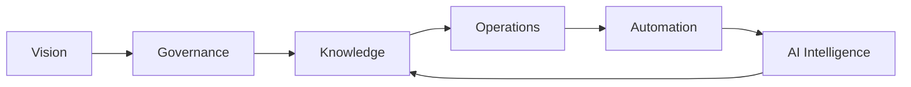
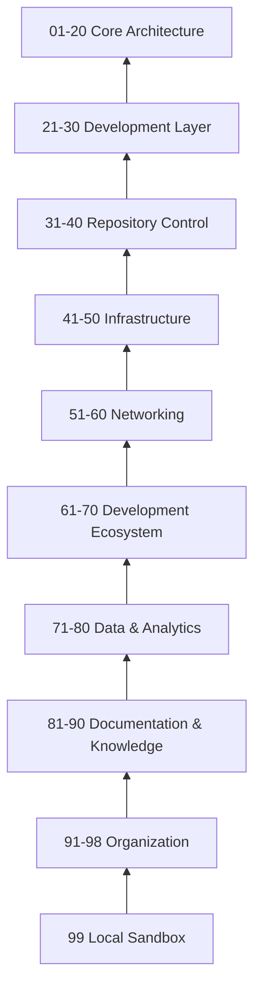
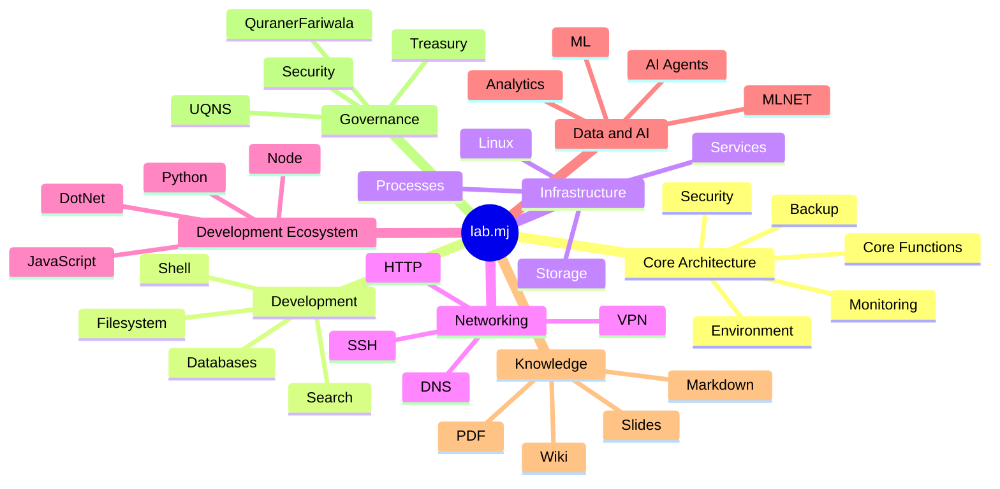
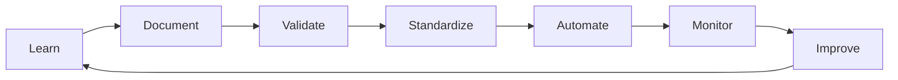

---
hide:
  - toc
---

# Sovereign Knowledge Laboratory

> **A Sovereign Knowledge Operating System (KOS)**
>
> Infrastructure • Development • AI • Knowledge • Governance • Organizational Intelligence

---

## Mission

Sovereign Knowledge Laboratory exists to transform fragmented experience, documentation, code, infrastructure, governance, and research into a unified, searchable, auditable, and continuously improving knowledge system.

This platform serves as:

- Knowledge Operating System
- Documentation Hub
- Engineering Handbook
- Infrastructure Runbook
- AI Operations Platform
- Governance Repository
- Organizational Memory System

---

<div class="hero-banner">

### Knowledge → Systems → Intelligence

Build once. Document forever.

Learn → Document → Standardize → Automate → Audit → Improve

</div>

---

## Executive Dashboard

| Capability | Status |
|------------|---------|
| Core Architecture | 🟢 Operational |
| Development Platform | 🟢 Operational |
| Infrastructure | 🟢 Operational |
| Networking | 🟢 Operational |
| Documentation | 🟢 Operational |
| Data & Analytics | 🟢 Operational |
| AI Platform | 🟡 Expanding |
| Knowledge Graph | 🟡 Growing |
| Governance | 🟢 Operational |
| Organizational Intelligence | 🟢 Operational |

---

## System Operating Model



---

## Architecture Pyramid



---

# Domain Navigator

<div class="grid cards" markdown>

- :material-cog-outline:

    ## Core Architecture

    Foundation of the platform.

    Environment, functions, backup,
    security, monitoring, AI foundations.

    **Entry Point:** `01-env`

- :material-console:

    ## Development Layer

    Essential engineering tools.

    Shell, filesystem, archives,
    search, processing, databases.

    **Entry Point:** `21-shell`

- :material-source-branch:

    ## Repository Layer

    Version-controlled operations.

    GitHub, GitLab, Releases,
    CI/CD, changelog, automation.

    **Entry Point:** `31-github`

- :material-server:

    ## Infrastructure Layer

    Systems administration.

    Linux, services, users,
    processes, storage, scheduling.

    **Entry Point:** `41-linux`

</div>

<div class="grid cards" markdown>

- :material-lan:

    ## Networking Layer

    Communication and security.

    HTTP, DNS, SSH,
    VPN, proxy, firewall.

    **Entry Point:** `51-http`

- :material-code-tags:

    ## Development Ecosystem

    Programming environments.

    Java, Go, Rust,
    JavaScript, TypeScript.

    **Entry Point:** `61-java`

- :material-microsoft-dot-net:

    ## .NET Platform

    Microsoft ecosystem.

    .NET, ASP.NET Core,
    Entity Framework,
    ML.NET, Azure-ready services.

    **Entry Point:** `15-dotnet`

- :material-database:

    ## Data & Analytics

    Insights and intelligence.

    Data, analytics,
    reporting, ML, automation.

    **Entry Point:** `71-data`

</div>

<div class="grid cards" markdown>

- :material-robot-outline:

    ## AI Platform

    Context-Aware Intelligence.

    LLMs, AI Agents,
    Automation, Research Systems.

    **Entry Point:** `77-ai-agents`

- :material-book-open-variant:

    ## Documentation System

    Organizational memory.

    Markdown, PDF,
    DOCX, Slides, Diagrams.

    **Entry Point:** `81-readme`

- :material-bank:

    ## Governance System

    Policies and accountability.

    Roles, Treasury,
    Security, Contracts.

    **Entry Point:** `91-Foundational_Documents`

- :material-flask-outline:

    ## Sandbox

    Research & experimentation.

    Drafts, prototypes,
    validation and testing.

    **Entry Point:** `99-local`

</div>

---

## Capability Map



---

## Knowledge Lifecycle



---

## Learning Paths

### Engineer

```text
01-env
  ↓
21-shell
  ↓
31-github
  ↓
41-linux
  ↓
61-java / 66-javascript / 15-dotnet
```

---

### Infrastructure Administrator

```text
01-env
  ↓
10-security
  ↓
41-linux
  ↓
51-networking
  ↓
18-monitoring
```

---

### AI & Research

```text
17-ai
  ↓
71-data
  ↓
75-ml
  ↓
77-ai-agents
  ↓
80-research
```

---

### Documentation Architect

```text
09-docs
  ↓
81-readme
  ↓
82-markdown
  ↓
87-diagrams
  ↓
88-knowledgebase
```

---

## Governance Principles

!!! success "Knowledge First"

    Every solved problem becomes reusable knowledge.

!!! note "Documentation First"

    Knowledge does not exist until documented.

!!! tip "Automation First"

    Repetitive work should become automated systems.

!!! warning "Security First"

    Security is part of architecture, not an afterthought.

!!! info "Sovereignty First"

    Knowledge must remain portable, auditable, and independently verifiable.

---

## Repository Metadata

| Property | Value |
|----------|--------|
| Repository | mjdocs |
| Maintainer | MJ Ahmad |
| Platform | MkDocs Material |
| Architecture | Knowledge Operating System |
| Documentation Strategy | Docs-as-Code |
| Governance Model | Documentation First |
| Knowledge Model | Knowledge Graph Driven |
| AI Strategy | Human Guided AI |
| Version Control | Git |

---

## Long-Term Vision

Create a sovereign, AI-augmented, continuously evolving knowledge operating system capable of preserving and expanding organizational intelligence across generations.

---

## Quick Start

<div class="grid cards" markdown>

- **New Contributor**
    - Start → `01-env`

- **Developer**
    - Start → `21-shell`

- **.NET Engineer**
    - Start → `15-dotnet`

- **System Administrator**
    - Start → `41-linux`

- **Network Engineer**
    - Start → `51-http`

- **Data Engineer**
    - Start → `71-data`

- **AI Researcher**
    - Start → `77-ai-agents`

- **Technical Writer**
    - Start → `81-readme`

</div>

---

> **Knowledge compounds when it is structured.**
>
> **Documentation creates continuity.**
>
> **Automation scales execution.**
>
> **Governance preserves trust.**
>
> **AI amplifies intelligence.**
